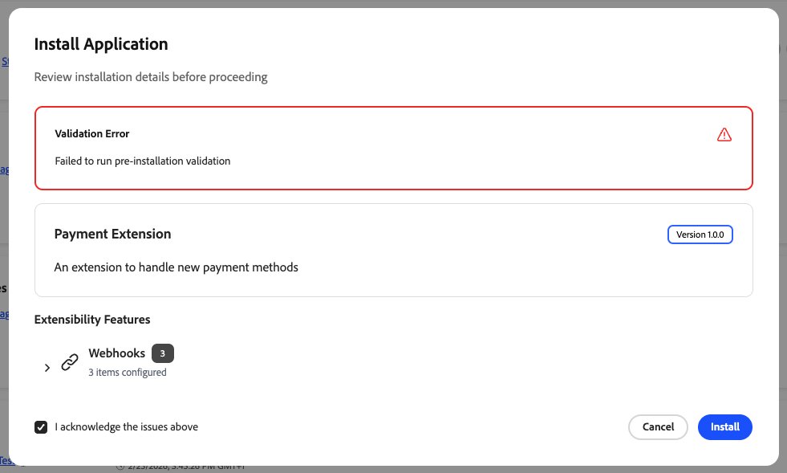

# 安裝及存取[!DNL App Management]

[!DNL App Management]可在Commerce Admin中取得符合資格的Commerce執行個體。 可用性取決於您的部署型別。

## 可用性

在符合下列要求之後，請在下方選取部署型別的對應標籤，以檢視[!DNL App Management]是否需要安裝，或已在您的執行個體上可用。

## 先決條件

建立應用程式關聯之前，請確定您具備下列條件：

| 需求 | 說明 |
|-------------|-------------|
| **管理員存取權** | 具有[!DNL App Management]許可權的Commerce管理員 |
| **已部署的應用程式** | App Builder應用程式已部署到您的組織並準備好連線 |
| **組織存取權** | 存取已部署應用程式的Adobe組織 |

>[!BEGINTABS]

>[!TAB Adobe Commerce as a Cloud Service]

[!DNL App Management]可在[!DNL Adobe Commerce as a Cloud Service]自動使用。 不需要安裝。 [在Admin](#access-app-management)中啟用它，並開始關聯應用程式。

>[!TAB 雲端(PaaS)和內部部署上的Adobe Commerce]

* **Adobe Commerce 2.4.8和更新版本**—[!DNL App Management]會自動包含在內。 不需要安裝。

* **Adobe Commerce 2.4.5至2.4.7** — 使用撰寫器安裝[!DNL Admin UI SDK] （包括[!DNL App Management]）：

  ```bash
  composer require "magento/commerce-backend-sdk": ">=3.3"
  ```

  然後執行：

  ```bash
  composer update
  bin/magento setup:upgrade
  bin/magento indexer:reindex
  bin/magento cache:clean
  ```

如需詳細資訊，請參閱[安裝或更新Adobe Commerce Admin UI SDK](https://developer.adobe.com/commerce/extensibility/admin-ui-sdk/installation/){target="_blank"}。

>[!ENDTABS]

## 存取[!DNL App Management]

1. 登入Commerce管理員。

1. 導覽至&#x200B;**[!UICONTROL Apps]** > **[!UICONTROL App Management]**。

顯示[!DNL App Management]檢視。 您可以在此建立App Builder應用程式的關聯、設定和管理。 如需該熒幕上的搜尋、篩選和&#x200B;**[!UICONTROL Acquire App]**&#x200B;動作，請參閱[管理您的應用程式](manage-app.md)中的[在管理員中尋找應用程式](manage-app.md#find-an-application-in-the-admin)。

## 安裝App Builder應用程式

如果您需要從Adobe Exchange安裝App Builder應用程式（例如預先建立的整合或市集應用程式），請參閱[從Adobe Exchange安裝App Builder應用程式](https://experienceleague.adobe.com/en/docs/commerce-learn/tutorials/extensibility/adobe-developer-app-builder/install-app-builder-app){target="_blank"}以取得逐步指示。

安裝及部署應用程式後，請使用[!DNL App Management]將其與您的Commerce執行個體建立關聯[&#128279;](manage-app.md#associate-an-app)，並設定其設定。

## Commerce webhook和應用程式

部分App Builder應用程式會使用[Adobe Commerce webhook](https://developer.adobe.com/commerce/extensibility/webhooks/)，讓Commerce可以在特定事件發生時（例如在儲存產品後），透過HTTP呼叫您的應用程式。 Webhook端點和訂閱邏輯是由&#x200B;**應用程式開發人員**&#x200B;在應用程式建置和部署時定義；商店管理員不會在App Management中個別設定Webhook。

在您[將應用程式](https://experienceleague.adobe.com/en/docs/commerce/app-management/manage-app/manage-app)與您的Commerce執行個體建立關聯，並從應用程式完成任何設定指示之後，webhook行為會遵循應用程式的實作。

如果[!DNL App Management]無法觸發應用程式的驗證端點（例如URL無法連線或回應不符合要求），您可能會在[!DNL App Management]儀表板中看到類似下列的錯誤：

{width="600" zoomable="yes"}

請與&#x200B;**應用程式開發人員**&#x200B;合作，更正webhook設定或部署，讓驗證能夠成功。

**應用程式開發人員**。 若要從App Builder實作Webhook訂閱和處理常式回應，請參閱Commerce擴充性開發人員檔案中的[Webhooks](https://developer.adobe.com/commerce/extensibility/app-management/installation/webhooks/)和GitHub上的[`@adobe/aio-commerce-lib-webhooks`](https://github.com/adobe/aio-commerce-sdk/tree/main/packages/aio-commerce-lib-webhooks)套件。
