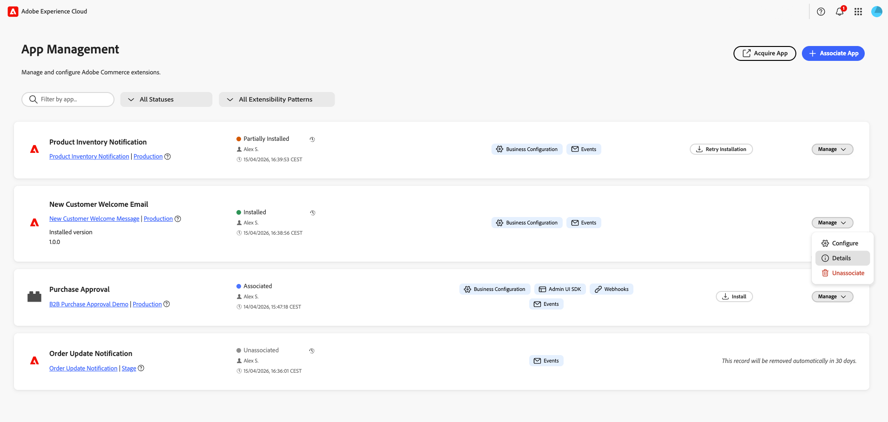
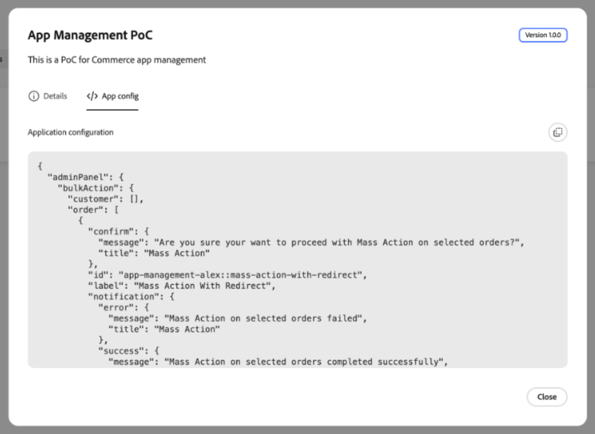
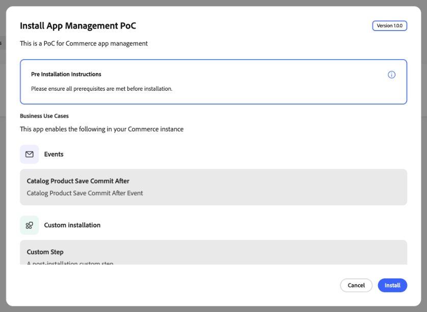

# 管理您的應用程式

使用[!DNL App Management]將App Builder應用程式與您的Commerce執行個體建立關聯、安裝、設定、升級和取消關聯。 組態表單是從每個應用程式的結構描述產生，因此您不需要自訂管理員UI開發即可管理設定。

{width="500" zoomable="yes"}

## 在Admin中尋找應用程式

在&#x200B;**[!UICONTROL Apps]** > **[!UICONTROL App Management]**&#x200B;下，每個應用程式都會顯示為卡片。 清單可包含與所選Adobe IMS組織的Adobe Commerce執行個體相關聯的每個應用程式。 使用卡片上方的控制項來縮小結果範圍：

| 控制 | 說明 |
| --- | --- |
| **[!UICONTROL Filter by app...]** | 依應用程式名稱搜尋。 |
| **[!UICONTROL Status]** | 依生命週期狀態限制卡片。 **[!UICONTROL All Statuses]**&#x200B;顯示每個應用程式；其他值包括&#x200B;**[!UICONTROL Associated]**、**[!UICONTROL Installed]**、**[!UICONTROL Partially Installed]**&#x200B;和&#x200B;**[!UICONTROL Unassociated]**。 每張卡片上的狀態與清單中的彩色指標相符。 |
| **[!UICONTROL Extensibility patterns]** | 根據應用程式使用的功能限制卡片。 **[!UICONTROL All Extensibility Patterns]**&#x200B;顯示每個應用程式；其他值與每個卡片上的徽章對齊，例如&#x200B;**[!UICONTROL Business Configuration]**、**[!UICONTROL Admin UI SDK]**、**[!UICONTROL Webhooks]**&#x200B;和&#x200B;**[!UICONTROL Events]**。 |

搜尋欄位和兩個篩選器會同時套用。 若要再次顯示完整清單，請清除搜尋欄位並選取&#x200B;**[!UICONTROL All Statuses]**&#x200B;和&#x200B;**[!UICONTROL All Extensibility Patterns]**。

### 檢閱應用程式詳細資料

在應用程式的卡片上，選取&#x200B;**[!UICONTROL Manage]** > **[!UICONTROL Details]**&#x200B;以檢閱其名稱、說明和版本。 對話方塊提供兩個標籤：

* **[!UICONTROL Details]**&#x200B;列出應用程式的業務使用案例，包括事件和自訂安裝步驟。 檢閱標籤和說明，以瞭解應用程式新增至Commerce的內容。
* **[!UICONTROL App config]**&#x200B;將應用程式的設定顯示為JSON以供檢查。

{width="600" zoomable="yes"}

{width="600" zoomable="yes"}

## 贏取應用程式

**[!UICONTROL Acquire App]**&#x200B;會開啟新的瀏覽器索引標籤（或獨立的瀏覽器檢視），以存取[Adobe Exchange](https://exchange.adobe.com/apps/browse/ec){target="_blank"}，您可在此探索Commerce相關的市集清單，並將應用程式新增至您的Adobe IMS組織。 取得、核准及部署應用程式後，應用程式會出現在[關聯](#associate-an-app)和[安裝](#install-an-app)的[!DNL App Management]中。

## 先決條件

建立應用程式關聯之前，請確定您具備下列條件：

| 需求 | 說明 |
| --- | --- |
| **管理員存取權** | 具有[!DNL App Management]許可權的Commerce管理員 |
| **已部署的應用程式** | App Builder應用程式已部署到您的組織並準備好連線 |
| **組織存取權** | 存取已部署應用程式的Adobe組織 |

## 教學課程

觀看此影片，瞭解如何將應用程式與Commerce執行個體建立關聯並設定設定。

>[!VIDEO](https://video.tv.adobe.com/v/3478944)

## 關聯應用程式

關聯程式會從Commerce匯入網站、商店和商店檢視，以及在應用程式和您的Commerce執行個體之間建立連結。

若要將您的App Builder應用程式連結至Commerce執行個體：

1. 導覽至&#x200B;**[!UICONTROL Apps]** > **[!UICONTROL App Management]**。

1. 按一下&#x200B;**[!UICONTROL Associate App]**。

   {width="500" zoomable="yes"}

1. 從清單中選取&#x200B;**[!UICONTROL Project]**。

1. 選取&#x200B;**[!UICONTROL Workspace]**。

1. 按一下&#x200B;**[!UICONTROL Associate]**。

   {width="500" zoomable="yes"}

>[!WARNING]
>
>如果範圍同步失敗，關聯仍會完成。 您稍後可以從關聯應用程式組態中的&#x200B;**[!UICONTROL Manage Scopes]**&#x200B;檢視手動同步範圍。

## 安裝應用程式

關聯會將應用程式連結至您的Commerce執行個體。 對於包含可安裝元件的應用程式（例如事件、webhook、管理員UI擴充功能或自訂安裝步驟），安裝會將這些元件套用至執行個體。

1. 在[!DNL App Management]中開啟關聯應用程式的安裝對話方塊。

1. 檢閱應用程式的業務使用案例和列出的安裝步驟。

1. 如果顯示&#x200B;**[!UICONTROL Pre Installation Instructions]**，請先完成這些先決條件再繼續。

   {width="600" zoomable="yes"}

1. 按一下&#x200B;**[!UICONTROL Install]**。

1. 監視個別專案的進度指示器，直到安裝完成。

   {width="600" zoomable="yes"}

   >[!WARNING]
   >
   >保持頁面開啟，直到安裝完成。 關閉或重新整理頁面可能會使安裝無法正確完成。

1. 確認已顯示&#x200B;**[!UICONTROL Successfully Installed]**&#x200B;且已完成專案具有核取標籤。

   {width="600" zoomable="yes"}

1. 完成應用程式提供的任何安裝後指示，然後視需要[設定其設定](#configure-settings)。

## 設定設定

在[!DNL App Management]檢視中建立應用程式關聯後，請透過表單設定其設定：

1. 在關聯應用程式的卡片上，選取&#x200B;**[!UICONTROL Manage]** > **[!UICONTROL Configure]**。

表單會顯示應用程式可設定的設定。

1. 視需要修改值。

1. 按一下&#x200B;**[!UICONTROL Save]**。

### 範圍特定設定

當不同的網站、商店或商店檢視需要唯一的設定時，請使用範圍特定的設定。 例如，僅針對特定區域或商店檢視啟用功能，或針對每個品牌使用不同的設定。 較低範圍的設定會覆寫較高範圍的設定。

覆寫特定範圍層級的全域值：

1. 按一下&#x200B;**[!UICONTROL Change Scope]**。

1. 從清單中選取範圍。

1. 修改此範圍的值。

1. 按一下&#x200B;**[!UICONTROL Save]**。

## 管理範圍

從應用程式詳細資訊畫面存取&#x200B;**[!UICONTROL Manage Scopes]**&#x200B;以管理您應用程式的範圍階層。

{width="500" zoomable="yes"}

| 動作 | 說明 |
| --- | --- |
| **[!UICONTROL Add root scope]** | 新增僅套用至應用程式的範圍。 |
| **[!UICONTROL Sync Commerce scopes]** | 新增或變更網站、商店和商店檢視後，從Commerce重新整理清單。 |
| **[!UICONTROL Import scopes]** | 從檔案大量匯入範圍。 |

## 升級應用程式

當您的應用程式開發人員部署已安裝應用程式的新版本時，[!DNL App Management]會收到升級可用的通知。 App Builder部署和App Management升級是獨立的操作：升級會將計畫的變更套用至已安裝的元件，例如事件、webhook和管理UI擴充功能。

請要求應用程式開發人員確認應用程式支援升級。 如需SDK必要條件和移轉需求，請參閱開發人員檔案中的[升級您的應用程式](https://developer.adobe.com/commerce/extensibility/app-management/upgrade-app/){target="_blank"}。

### 檢閱並開始升級

在手動模式（預設值）中，您會在[!DNL App Management]中檢閱並開始升級。

1. 紀錄已安裝的應用程式版本和設定，並在應用程式開發人員的協助下，備份應用程式資料和外部資源。

1. 導覽至&#x200B;**[!UICONTROL Apps]** > **[!UICONTROL App Management]**，然後開啟應用程式的可用升級。

1. 檢閱計畫的變更和任何警告。 升級可以新增、修改或移除元件。 如果移除自訂安裝步驟，則不會執行其解除安裝指令碼，且不會自動清除其建立的資源。 繼續之前，請向應用程式開發人員確認任何必要的清理作業。

1. 開始升級，並監視所列作業的進度。

1. 檢閱升級結果，並檢查是否有失敗的作業。 如果升級失敗，請在使用&#x200B;**[!UICONTROL Retry Upgrade]**&#x200B;之前執行[升級失敗](troubleshooting.md#upgrade-fails)。

在手動模式中，除非您開始升級，否則不會套用已安裝Commerce元件的計畫變更。 不過，部署可以在升級執行前，更新已安裝應用程式已使用的執行階段動作程式碼。

### 自動升級

您的應用程式開發人員會控制升級模式。 請要求開發人員確認應用程式是使用手動還是自動升級。

>[!WARNING]
>
>自動升級是實驗性的，並在部署後啟動，無需管理員稽核，包括可修改外部資源的自訂安裝指令碼。 在啟用自動升級之前（包括新部署的版本將模式從手動變更為自動時），請與您的開發人員協調。

### 企業設定變更

應用程式的商務設定結構描述變更會在部署後自動顯示。 它們與安裝和升級分開，不會觸發應用程式升級。

## 取消關聯應用程式

當您不再需要應用程式連線至您的Commerce執行個體時，請取消關聯應用程式。 例如，您可能需要淘汰整合、切換到不同的工作區或清除測試設定。

>[!WARNING]
>
>取消關聯會移除此執行處理的所有組態值。 此動作無法還原。 解除安裝也可以透過自訂解除安裝指令碼移除應用程式元件和資源。

繼續之前，請記錄已安裝的版本和設定、備份應用程式資料，並詢問應用程式開發人員應用程式的解除安裝指令碼移除哪些資源，以及需要手動清理。 規劃任何服務中斷，以及如何還原應用程式、其設定和資料。 對於例行更新，[升級應用程式](#upgrade-an-app)，而不是解除其關聯。

若要從Commerce例項移除應用程式：

1. 導覽至&#x200B;**[!UICONTROL Apps]** > **[!UICONTROL App Management]**。

1. 在應用程式的卡片上，選取&#x200B;**[!UICONTROL Manage]** > **[!UICONTROL Unassociate]**。

1. 檢閱列出的業務使用案例和受解除安裝影響的元件，包括事件和自訂安裝步驟。

   {width="600" zoomable="yes"}

1. 確認動作。

## 相關檔案

* [疑難排解 [!DNL App Management]](troubleshooting.md) — 解決關聯、安裝、設定和升級的常見問題。
* [升級您的應用程式](https://developer.adobe.com/commerce/extensibility/app-management/upgrade-app/){target="_blank"} — 開發人員對升級模式、移轉指令碼和診斷的需求。
