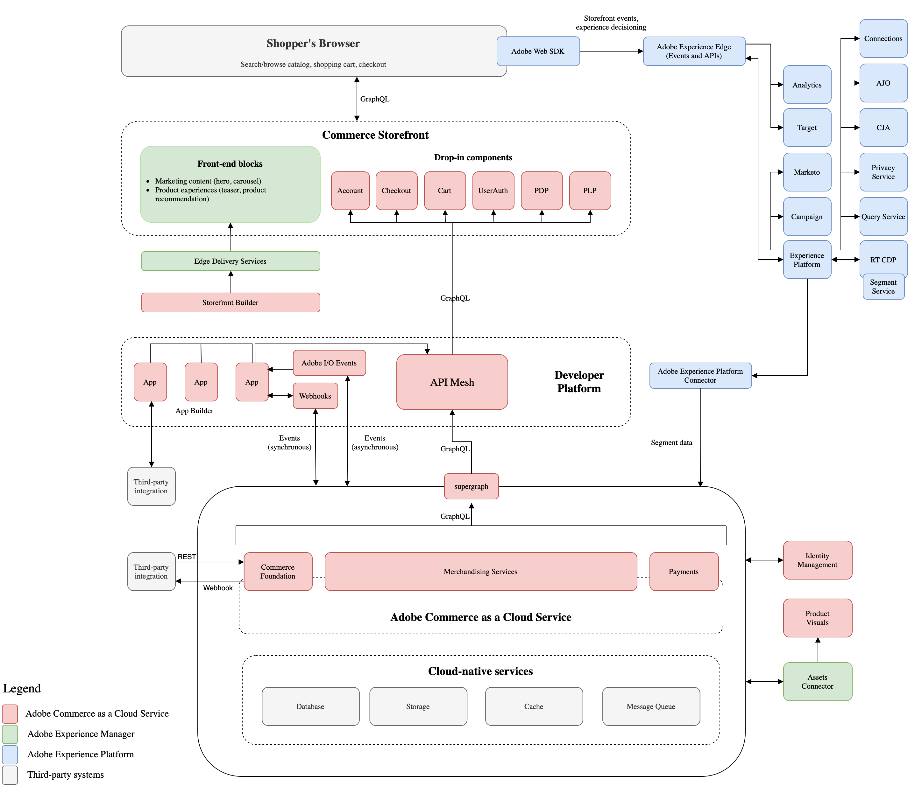

# 銷售服務

Adobe Commerce as a Cloud Service現在透過銷售服務支援可撰寫目錄資料模型(CCDM)。 Adobe Commerce Optimizer推出了此資料模型，而CCDM為兩款產品提供了提供店面目錄瀏覽與銷售功能的共同基礎，同時Commerce基金會持續管理產品、價格與交易。

本主題說明CCDM有何變更、功能會持續運作，以及變更對商家、合作夥伴和店面開發人員有何影響。

## CCDM會帶來哪些變更？

原始目錄模型使用目錄服務將產品資料傳遞至店面，而「即時搜尋」和「產品推薦」提供搜尋、銷售和推薦功能。 在此模型中，Commerce使用[SaaS資料匯出](https://experienceleague.adobe.com/en/docs/commerce/saas-data-export/overview)進行同步。

透過CCDM，這些功能會在支援Adobe Commerce Optimizer的相同目錄基礎上運作。 [目錄檢視](https://experienceleague.adobe.com/en/docs/commerce-admin/merchandising-with-ccdm/setup/catalog-view)和[原則](https://experienceleague.adobe.com/en/docs/commerce-admin/merchandising-with-ccdm/setup/policies)定義店面可用的目錄內容。 原則會決定產品分類，而銷售規則可套用至所有目錄檢視或針對特定檢視量身打造。

這會變更目錄的設定、存取及銷售方式。 CCDM以原始Commerce目錄的搜尋、建議和銷售功能為基礎，同時在目錄檢視層級引入控制項。 其他管理和報告功能如下所述。

Commerce Foundation依然是產品和價格的標準來源。 產品和價格資料會透過原生Adobe Commerce as a Cloud Service整合，以單向同步至CCDM。 網站、商店和商店檢視設定會保留在Commerce中，與現有購物車、結帳和訂單管理工作流程並存。

## 授權與布建

銷售服務包含在現有的Adobe Commerce as a Cloud Service SKU中。 這不是第二個產品或訂閱，不需要另外購買Adobe Commerce Optimizer、權益或租使用者。

## 架構概覽

[!DNL Commerce Foundation]仍然是產品和價格的主要記錄，並繼續管理交易。 原生整合會從[!DNL Commerce]單向將產品與價格資料同步至CCDM。 您不為此同步處理安裝個別的聯結器或[!DNL App Builder]應用程式。

店面使用CCDM支援的銷售服務來擷取目錄資料和內容，以進行瀏覽、搜尋、建議和銷售。 要求使用目錄內容來擷取預定對象的產品和價格。 您繼續在[!DNL Commerce]中管理網站、商店和商店檢視設定。

下圖顯示銷售服務在更廣泛的Adobe Commerce as a Cloud Service架構中的位置。

{zoomable="yes"}

## 商家有哪些新增功能？

新模型可讓您將現有銷售規則範圍限定在所有目錄檢視或特定檢視。 這可讓您將銷售套用至每個店面對象。 瞭解如何[將銷售規則範圍設定為目錄檢視](https://experienceleague.adobe.com/en/docs/commerce-admin/merchandising-with-ccdm/merchandising/rules/add)。

在Admin中，您可以使用[!UICONTROL Catalog Views]和[!UICONTROL Policies]來設定目錄內容。 您也可以使用[!UICONTROL Success Metrics]來檢閱收入、轉換、參與、贏取和跳出率。 如需詳細資訊，請參閱[成功量度](https://experienceleague.adobe.com/en/docs/commerce-admin/merchandising-with-ccdm/manage-results/success-metrics)。

## 採用前的考量事項

在採用銷售服務之前，請先檢閱CCDM模式如何影響您的授權、目錄整合、店面和管理工作流程。

### 目錄管理和整合

繼續管理[!DNL Commerce Foundation]中的產品和價格。 原生整合會將它們同步至CCDM。 請勿為Merchandising Services建立第二個產品目錄。

### 店面實施

您的店面如何擷取目錄資料取決於您的實作：

- **[!DNL Adobe Commerce Storefront]**&#x200B;個下拉式清單 — 下拉式清單可處理轉換。 不需要變更程式碼。 請參閱[店面設定檔案](https://experienceleague.adobe.com/en/tools/commerce-storefront/)。
- **自訂或其他店面** — 更新您的目錄要求標頭，如[標頭組態參考](https://experienceleague.adobe.com/en/tools/commerce-storefront/setup/configuration/commerce-configuration/#headers)中所述。

檢閱目錄查詢和請求標頭，以取得以CCDM為基礎的模型。 請勿假設現有查詢或標題保持不變。 銷售GraphQL查詢與原始目錄服務模型中使用的查詢不同。 其他查詢支援CCDM。 使用[銷售GraphQL API參考](https://developer.adobe.com/commerce/services/reference/graphql/)，並根據[店面標題參考](https://experienceleague.adobe.com/en/tools/commerce-storefront/setup/configuration/commerce-configuration/#headers)驗證必要的目錄內容。

### 協力廠商應用程式和擴充功能

檢閱讀取目錄資料或透過其提供者使用目錄事件的第三方應用程式和擴充功能。 相容性取決於每個應用程式或擴充功能使用這些介面的方式。

### 管理體驗

Adobe Commerce as a Cloud Service與CCDM使用[[!DNL Adobe Unified Experience]](https://experienceleague.adobe.com/en/docs/commerce-admin/start/admin/admin-unified-experience) (Unified Shell)。 Adobe已單獨發行Unified Shell與CDM。 原始目錄服務模型上的現有執行個體仍可存取Classic和Unified Shell。

### 限制

CCDM模式不會變更Adobe Commerce as a Cloud Service限制。 與Optimizer共用目錄基礎並不表示Commerce會繼承Optimizer容量或限制。

## 可用性與移轉

在此版本發行後開始使用Adobe Commerce as a Cloud Service的組織依預設會收到銷售服務。 如果您的組織需要原始目錄資料模型，請聯絡您的Adobe客戶團隊以討論是否有例外可用。

在此版本之前具有Adobe Commerce as a Cloud Service的組織可在[布建新執行個體](./getting-started.md#create-an-instance)時選擇任一目錄模型。 根據預設，[!UICONTROL Enable CCDM]切換器已停用。 啟用CCDM後，您就無法加以停用。

現有執行個體不會自動變更。 一般可用性(GA)下，您無法將現有的原始目錄服務執行個體移轉至「銷售服務」。
