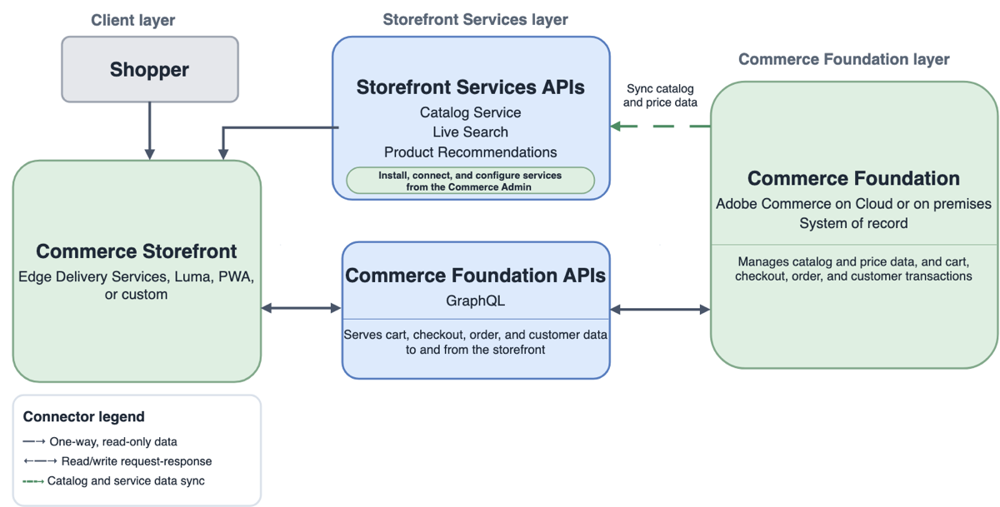

# 實作架構選項

Adobe Commerce實作架構結合三層：商務後端（[!DNL Adobe Commerce]或[!DNL Adobe Commerce Optimizer]）、店面以及一組連線的服務和整合。 比較下列選項，以識別哪些系統擁有每個架構中的目錄、定價、購物車、結帳、訂單及客戶交易。

## 架構選項摘要

依交易擁有權和店面體驗比較選項。

### Commerce平台與交易

| 選項 | 記錄系統 | 交易路徑 | 最適化 |
| --- | --- | --- | --- |
| **[!DNL Adobe Commerce as a Cloud Service]與Commerce Foundation** | Adobe管理的Commerce Foundation | 受管理的Commerce Foundation和連線的Commerce服務 | 想要降低Adobe管理軟體服務(SaaS) Commerce基礎架構擁有權的客戶 |
| 雲端或具有&#x200B;[!DNL Adobe Commerce Optimizer Connector]**的內部部署上的**[!DNL Adobe Commerce] | 現有的Commerce Foundation，適用於Commerce資料和交易 | 現有的Commerce Foundation API和連線交易服務 | 想要將Optimizer探索與銷售功能新增至現有[!DNL Adobe Commerce]部署的客戶 |
| **獨立[!DNL Adobe Commerce Optimizer]，具有外部商務後端** | 現有或第三方商務平台。 從外部來源將目錄和價格資料新增到Optimizer | API Mesh、App Builder或直接整合將店面連線至第三方購物車、結帳、客戶、訂單、付款、稅務、配送和履行服務 | 想要同時保留現有或第三方交易式商務平台且想要最佳化工具功能的客戶 |
| 雲端或具有Commerce Foundation的內部部署上的&#x200B;**[!DNL Adobe Commerce]** | Commerce Foundation | Commerce Foundation API與已設定的付款、稅捐、運送、存貨和履行整合 | 需要完整[!DNL Adobe Commerce]平台且具備雲端或內部部署基礎結構的部署控制的客戶 |

### 店面體驗

Storefront連線至Commerce Foundation API、Storefront Services （[!DNL Catalog Service]、[!DNL Live Search]和[!DNL Product Recommendations]）或[!DNL Adobe Commerce Optimizer]銷售服務。

| 選項 | 店面體驗 | 店面資料路徑 |
| --- | --- | --- |
| **[!DNL Adobe Commerce as a Cloud Service]與Commerce Foundation** | 由Edge Delivery Services或其他支援的Headless體驗提供支援的Commerce店面 | Storefront Services，加上適用於核心平台資料的Commerce Foundation API |
| 雲端或具有&#x200B;[!DNL Adobe Commerce Optimizer Connector]**的內部部署上的**[!DNL Adobe Commerce] | 使用Optimizer體驗的Edge Delivery Services或自訂Headless店面 | 適用於Optimizer管理目錄與銷售資料的Commerce Optimizer銷售服務GraphQL API |
| **獨立[!DNL Adobe Commerce Optimizer]，具有外部商務後端** | 由Edge Delivery Services提供支援的Commerce店面或自訂無頭店面 | 適用於目錄與銷售資料的Commerce Optimizer銷售服務GraphQL API |
| 雲端或具有Commerce Foundation的內部部署上的&#x200B;**[!DNL Adobe Commerce]** | Edge Delivery Services、Luma、PWA或自訂Headless店面 | Commerce Foundation API，以及設定後的店面服務 |

## Adobe Commerce as a Cloud Service

{width="600" zoomable="yes"}

**索引鍵界限**—Adobe管理Commerce Foundation平台。 此架構使用店面服務作為店面體驗，包括[!DNL Catalog Service]、[!DNL Live Search]和[!DNL Product Recommendations]。 由AEM Assets支援的[!DNL Product Visuals]是選用的SaaS整合。 請參閱[Commerce的AEM Assets整合](../aem-assets/aem-assets-integration.md)。

**參考：**

- [[!DNL Adobe Commerce as a Cloud Service] 概覽](/help/cloud-service/overview.md)
- [Commerce店面](https://experienceleague.adobe.com/en/tools/commerce-storefront/)
- [Storefront Services GraphQL結構描述](https://developer.adobe.com/commerce/webapi/graphql/schema/storefront-services/)

## Adobe Commerce與Commerce Foundation

{width="600" zoomable="yes"}

**索引鍵界限**—Commerce Foundation擁有Commerce平台和交易流程。 設定後，[!DNL Catalog Service]、[!DNL Live Search]和[!DNL Product Recommendations]可提供目錄、搜尋和建議的最佳化店面存取權。 AEM Assets整合為選用。 請參閱[Commerce的AEM Assets整合](../aem-assets/aem-assets-integration.md)。

**參考：**

- [Commerce店面](https://experienceleague.adobe.com/en/tools/commerce-storefront/)
- [COMMERCE GRAPHQL API](https://developer.adobe.com/commerce/webapi/graphql/)
- [Storefront Services GraphQL結構描述](https://developer.adobe.com/commerce/webapi/graphql/schema/storefront-services/)

## Adobe Commerce與Optimizer聯結器

{width="600" zoomable="yes"}

**金鑰界限** — 聯結器會將目錄和價格資料從[!DNL Adobe Commerce]同步至[!DNL Adobe Commerce Optimizer]。 [!DNL Adobe Commerce]仍然是交易系統，而Optimizer透過其Merchandising Services API提供探索和銷售體驗。

**參考：**

- [Commerce Optimizer整合](/help/optimizer/integrations/integrations-overview.md)
- [Commerce Optimizer銷售服務](https://developer.adobe.com/commerce/services/optimizer/merchandising-services/)
- [COMMERCE GRAPHQL API](https://developer.adobe.com/commerce/webapi/graphql/)
- [Commerce店面](https://experienceleague.adobe.com/en/tools/commerce-storefront/)

## 具有第三方後端的獨立Commerce Optimizer

{width="800" zoomable="yes"}

**索引鍵界限** — 獨立的[!DNL Adobe Commerce Optimizer]擁有目錄探索和銷售體驗，但不擁有交易式Commerce後端。 透過Data Ingestion REST API輸入的目錄和價格資料。 Edge Delivery Services店面使用銷售服務GraphQL API提供產品體驗，並連線至協力廠商後端進行購物車和結帳。

**參考：**

- [什麼是Adobe Commerce Optimizer？](/help/optimizer/overview.md)
- [Commerce Optimizer資料擷取](https://developer.adobe.com/commerce/services/optimizer/data-ingestion/)
- [Commerce Optimizer銷售服務](https://developer.adobe.com/commerce/services/optimizer/merchandising-services/)
- [Commerce店面](https://experienceleague.adobe.com/en/tools/commerce-storefront/)

## 術語快速參考

| 偏好的詞語 | 含義 | 避免使用作為目前的架構標籤 |
| --- | --- | --- |
| **Commerce Foundation** | 基本商務和異動功能 | 核心Commerce、PHP基礎層 |
| **店面服務** | 目錄服務、即時搜尋和產品推薦的店面導向API | 標籤限製為只有一個Commerce平台 |
| **Commerce Optimizer銷售服務** | 適用於目錄探索和銷售體驗的Optimizer API | Commerce Foundation API |
| **由Edge Delivery Services提供支援的Commerce店面** | 面向客戶的店面實作 | API系列 |

## 相關指引

- [參考架構](reference-architectures.md)
- [選擇Commerce選項](../portfolio/choose-commerce-option.md)
- [店面](../storefronts/overview.md)
- [API](../apis/commerce-apis.md)
