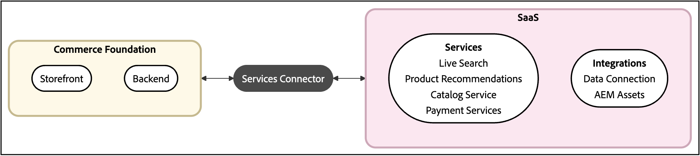

# Adobe Commerce Services指南

Adobe Commerce服務提供可組合的功能，可擴充店面體驗、連結Adobe和協力廠商解決方案，並幫助管理商務資料。

>[!NOTE]
>
>Adobe Commerce服務的可用性、設定和擴充功能選項因Commerce部署模式和服務而異。 請務必查閱服務特定指南，以取得最準確的資訊。

## Commerce如何連線至服務？

針對需要它的服務，[Commerce Services Connector](https://experienceleague.adobe.com/en/docs/commerce/user-guides/integration-services/saas)會使用API金鑰和SaaS資料空間，將Commerce執行個體連線到支援的服務。 連線和資料同步步驟取決於部署模式與服務。

設定Commerce Services Connector後，您就可以存取下列功能：

* **店面服務** — 產品探索、建議和付款的AI支援功能
* **整合服務** — 連線至Adobe Experience Platform、AEM Assets和其他Adobe解決方案

這些服務可協助您提高轉換率、提供個人化體驗，以及在Adobe生態系統中更妥善地使用您的商務資料。

>[!NOTE]
>
>Adobe建議升級至所有Commerce服務的最新支援版本。 請參閱[發行說明](release-notes-all.md)。

## 可用的服務

下列清單會依功能將服務分組。 PaaS和SaaS之間的可用性、授權和設定可能有所不同，並可依服務版本變更。 請遵循每個連結指南中的部署模型標籤和先決條件。

>[!BEGINTABS]

>[!TAB 店面服務]

店面服務是一組AI支援的功能，可最佳化產品探索、個人化客戶互動，以及簡化付款處理，以提高參與度和轉換率。 透過店面服務，您可以提升購物體驗並推動業務成長。

<table style="table-layout:fixed">
<tr style="border: 0;">
   <td valign="top">
      
      

         <a href="../catalog-service/overview.md">
         <strong>目錄服務</strong>
         </a>
      

      

         <em>提供客戶最佳化的產品體驗，同時提升效能、改善擴充能力，並提高轉換率。</em>
      

   </td>
   <td valign="top">
      
      

         <a href="../live-search/overview.md">
         <strong>[!DNL Live Search]</strong>
         </a>
      

      

         <em>實作這個AI支援的搜尋工具，為B2C購物者提供更聰明、更快、更相關的結果。</em>
      

   </td>
   <td valign="top">
      
      

         <a href="../product-recommendations/overview.md">
         <strong>產品建議</strong>
         </a>
      

      

         <em>根據購物者行為、熱門趨勢、產品相似度等等，新增AI輔助建議。</em>
      

   </td>
   <td valign="top">
      
      

         <a href="../payment-services/guide-overview.md">
         <strong>付款服務</strong>
         </a>
      

      

         <em>透過多種付款方式提高客戶滿意度，包括免息分期付款，以及簡化付款處理、訂單及發票的檢視。</em>
      

   </td>
</tr>
</table>

>[!NOTE]
>
>
>Adobe Commerce Optimizer以原生方式提供目錄和銷售功能，而不使用個別的即時搜尋、目錄服務和產品推薦服務。 請參閱[什麼是Adobe Commerce Optimizer？](../optimizer/overview.md)
>
>對於與Optimizer整合的Adobe Commerce部署，Adobe Commerce Optimizer聯結器會處理目錄和價格同步作業，而不需要Commerce服務聯結器進行該同步作業。 其他整合（例如[付款服務](../payment-services/compatibility.md)和[資料連線](../data-connection/connect-data.md#configure-the-commerce-services-connector)）仍需要Commerce服務聯結器。 請參閱[設定Adobe Commerce的聯結器](https://experienceleague.adobe.com/en/docs/commerce/aco-optimizer-connector/get-started/get-started)。

>[!TAB 整合服務]

整合服務是指將您的Commerce執行個體連線到Adobe中其他產品或服務的功能。

<table style="table-layout:fixed">
<tr style="border: 0;">
   <td valign="top">
      
      

         <a href="../data-connection/overview.md">
         <strong>[!DNL Data Connection]</strong>
         </a>
      

      

         <em>利用Adobe Commerce與Adobe Experience Platform Edge之間的連線，將Commerce資料用於其他Adobe Experience Cloud產品，例如Adobe Analytics和Adobe Target。</em>
      

   </td>
   <td valign="top">
      
      

          <a href="../aem-assets-integration/overview.md">
         <strong>AEM Assets整合</strong>
         </a>
      

      

         <em>使用與Adobe Experience Manager整合的系統簡化數位資產管理，以管理多媒體內容。</em>
      

   </td>
   <td valign="top">
      
      

         <a href="../app-management/overview.md">
         <strong>應用程式管理</strong>
         </a>
      

      

         <em>透過Admin UI將App Builder應用程式與您的Commerce執行個體建立關聯、設定和管理。</em>
      

   </td>
</tr>
</table>

>[!TAB 資料工具]

資料工具可協助您管理並最佳化Commerce執行個體與連線服務之間的資訊流。 這些工具可確保有效率的資料同步化、監控同步作業，並藉由解除安裝資源密集的程式來改善效能。 其可用性和行為因服務和部署模式而異。 請參閱每本指南，瞭解設定指示、同步化、同步作業監控和效能詳細資訊。

<table style="table-layout:fixed">
<tr style="border: 0;">
   <td valign="top">
       
      

         <a href="../data-export/overview.md">
         <strong>[!DNL SaaS Data Export]</strong>
         </a>
      

      

         <em>自動將目錄、訂單及詳細目錄資料從Adobe Commerce同步至連線的服務。 使用Commerce CLI命令或<strong>資料管理儀表板</strong>來管理同步處理。</em>
      

   </td>
   <td valign="top">
      
      

          <a href="../price-index/price-indexing.md">
         <strong>SaaS價格索引器</strong>
         </a>
      

      

         <em>從Commerce應用程式解除安裝大量資源工作（例如索引和價格計算）至Adobe的雲端基礎結構，以最佳化網站效能。</em>
      

   </td>
   <td valign="top">
      
      

          <a href="https://experienceleague.adobe.com/en/docs/commerce-admin/systems/data-transfer/data-sync/data-dashboard" target="_blank">
         <strong>資料管理儀表板</strong>
         </a>
      

      

         <em>從Commerce管理員的統一儀表板輕鬆追蹤Commerce資料同步並觸發重新同步。 取得資料可用性的寶貴見解，以便及時向購物者顯示。</em>
      

   </td>
</table>

>[!NOTE]
>
>Commerce商戶可使用具有有效授權的產品建議v6.0.0、即時搜尋v4.1.0或目錄服務v1.17，不需額外付費，即可使用資料管理儀表板。 使用舊版服務的商家可以使用[目錄同步](../landing/catalog-sync.md)來管理和追蹤資料同步。

>[!ENDTABS]

## Commerce服務可以解決哪些問題？

無論您是想要擴展業務、改善客戶體驗，或做出資料導向式決策，Adobe Commerce服務都能提供解決方案，解決常見的Commerce挑戰：

| 問題 | 挑戰 | 解決方案 |
|---------|-----------|----------|
| 改善產品探索和轉換 | 購物者找不到想要的東西，導致高跳出率和銷售額下滑。 | 使用[即時搜尋](../live-search/overview.md)和[產品推薦](../product-recommendations/overview.md)，根據即時購物者行為，提供AI支援的搜尋功能，並具備拼寫錯誤容許度、即時「隨輸入搜尋」結果、動態多面向和個人化產品推薦。 |
| 建立全通道的個人化體驗 | 您的商務資料已設定為定址區，導致您無法跨管道提供個人化體驗。 | 使用[資料連線](../data-connection/overview.md)將行為、異動和設定檔資料傳送至Adobe Experience Platform。 建立複雜的客戶區段、建立捨棄的購物車行銷活動、鎖定相似對象，以及分析整個客戶歷程中的季節性趨勢。 |
| 簡化數位資產管理 | 跨多個系統管理產品影像和豐富媒體既費時又容易出錯。 | [AEM Assets整合](../aem-assets-integration/overview.md)將Adobe Commerce連線到Adobe Experience Manager Assets專案，簡化工作流程，確保所有接觸點都提供一致的品牌體驗，藉此提供集中式資產管理。 |
| 最佳化付款處理 | 有限的付款選項和不良的付款體驗，影響了客戶的滿意度和轉換。 | [付款服務](../payment-services/guide-overview.md)提供多種付款方式，包括免息分期付款，並有一個統一的控制面板來管理付款、訂單及發票。 |
| 大規模管理資料同步 | 資源密集的索引正在減慢網站的速度，而且您無法輕鬆追蹤資料同步問題。 | [SaaS資料匯出](../data-export/overview.md)、[SaaS價格索引器](../price-index/price-indexing.md)和[資料管理儀表板](https://experienceleague.adobe.com/en/docs/commerce-admin/systems/data-transfer/data-sync/data-dashboard)會自動同步目錄、訂單和存貨資料，將價格計算解除安裝到Adobe的雲端基礎結構，並即時顯示同步處理狀態。 |
| 挽回失去的客戶，降低回報 | 高客戶流失率和產品回報率正影響獲利能力。 | 將[資料連線](../data-connection/overview.md)與Adobe Journey Optimizer和Real-Time CDP結合，以識別傳回模式、建立回饋行銷活動、依行為劃分客戶，並透過電子郵件和簡訊傳送個人化的重新參與行銷活動。 |
| 制定資料導向銷售決策 | 您不確定要促銷哪些產品或何時要執行促銷活動。 | [即時搜尋](../live-search/overview.md)提供搜尋效能見解和銷售工具，以存取關鍵量度、分析搜尋字詞，並使用智慧型銷售規則，根據真正的客戶行為和業務目標來提升或隱藏產品。 |
| 維持對敏感資料的合規性 | 您需要處理敏感的客戶資料，同時維護HIPAA合規性。 | [Data Connection](../data-connection/overview.md)已可使用HIPAA，可讓您與Experience Platform共用後台資料，同時保持合規性並系統地處理隱私權要求。 |

## Commerce服務如何搭配運作

Adobe Commerce服務建置在統一的平台上，可結合以支援連線的店面、銷售、付款、資產和客戶資料工作流程。 使用多項服務時，您將受益於：

* **整合資料管道** — 產品、定價和庫存資料會在所有服務之間自動同步，不需要重複輸入資料或自訂整合。
* **即時個人化** — 搜尋、瀏覽和購買的客戶行為可支援智慧型建議，並在您整個店面進行排名。
* **一致的店面整合** — 無論您是使用由Edge Delivery Services、PWA Studio或Headless實作支援的Commerce店面，都可以存取增益集和API，以在所有平台上一致地提供商務體驗。
* **多商店和多語言支援** — 所有服務會自動遵循您的商店檢視、客戶區段和B2B目錄設定，不需要額外的設定。
* **豐富的產品視覺效果** — 當您與AEM Assets整合時，最佳化的產品影像會一致地出現在搜尋結果、產品頁面和建議中。
* **已連線的客戶資料** — 使用Data Connection與Adobe Experience Platform、Real-Time CDP和Journey Optimizer共用購物行為，以啟用跨管道個人化和行銷活動最佳化。

例如，當購物者使用即時搜尋來搜尋產品、在檢視產品推薦後將其新增到購物車，並使用支付服務完成購買時，所有這些活動都會順暢地流經統一資料管道。 然後，此行為資料可為未來購物者提供更好的搜尋結果和更相關的建議。

>[!NOTE]
>
>若要啟用與Adobe Experience Platform的行為資料共用，請在Data Connection中設定事件資料收集。 如需安裝指示，請參閱[資料連線資料集合](../data-connection/connect-data.md#data-collection)。

每項服務皆可單獨使用，但結合使用可建立更聰明且個人化的購物體驗。

{{$include /help/_includes/templated/whats-new.md}}

<!-- Last updated from includes: 2026-05-22 20:54:53 -->
