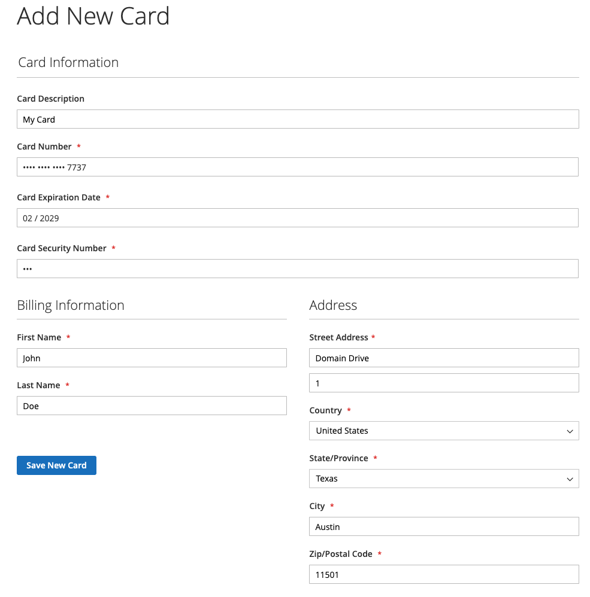

# 信用卡存放

透過信用卡保險庫將一次性購物者轉換為忠實客戶。 登入的客戶可以儲存（或「儲存庫」）他們的信用卡憑證，以便稍後為相同或其他相同商家帳戶內的商店購買時使用。

## 啟用存放區

商戶可以在[!DNL Payment Services] [設定](configure-admin.md#card-vaulting)中為其商店啟用信用卡保險存放。

1. 在&#x200B;_管理員_&#x200B;側邊欄上，移至&#x200B;**[!UICONTROL Sales]** > **[!UICONTROL Payment Services]**。

1. 按一下&#x200B;**[!UICONTROL Settings]**。

1. 切換&#x200B;**[!UICONTROL Vault enabled]**&#x200B;選取器。 如需詳細資訊，請參閱[啟用 [!DNL Payment Services]](configure-admin.md#enable-payment-services)。

## 儲存而不購買

登入的客戶可透過下列方式，在&#x200B;**我的帳戶**&#x200B;儀表板中儲存付款方法：

1. 登入店面他們的&#x200B;**我的帳戶**。

1. 瀏覽至左側導覽中的&#x200B;**[!UICONTROL Stored Payment Methods]**，檢視其所有儲存的付款方法。

   如需詳細資訊，請參閱[儲存的付款方法](https://experienceleague.adobe.com/en/docs/commerce-admin/stores-sales/payments/stored-payment-methods)。

1. 客戶按一下&#x200B;**[!UICONTROL Add New Card]**&#x200B;以儲存新卡片。

   {width="400" zoomable="yes"}

   客戶必須提供所有必要的詳細資訊（例如卡片與帳單資訊），以儲存付款方式。
   儲存卡時（購物者的PayPal帳戶中），所有儲存的付款方法都會使用帳單地址集。 客戶可能會看到與Commerce中顯示的帳單地址不同的帳單地址。

1. 按一下&#x200B;**[!UICONTROL Save New Card]**

   {width="400" zoomable="yes"}

儲存的卡片可以在下訂單時使用：

{width="400" zoomable="yes"}

### 刪除儲存的付款方法

客戶可以按一下特定卡片的&#x200B;**刪除**，從&#x200B;**我的帳戶**&#x200B;中的&#x200B;**儲存的付款方式**&#x200B;中輕鬆刪除存放的信用卡。

## 結帳時儲存付款方法

登入的客戶可在結帳時儲存信用卡，以便日後於目前商店或相同商家帳戶內的其他商店購買時使用：

{width="400" zoomable="yes"}

Commerce會儲存Token，協助客戶取得已儲存的信用卡資訊，完成未來的結帳作業。 從客戶帳戶或在結帳期間存放卡片將會導致不同的付款代號。

>[!WARNING]
>
> PayPal目前最多可儲存五張儲存的卡片。

## 在管理員中使用存放區

如果客戶先前擁有存放的信用卡，則商家可以使用任何這些存放的付款方式，在「管理員」中建立該客戶的後續訂單。

如果客戶同時擁有現有帳戶，且系統中儲存了先前完成付款的有效權杖，則您只能在「管理員」中使用存放卡。

若要在「管理員」中，使用客戶的保管式信用卡來建立訂單：

1. [建立訂單並新增產品](https://experienceleague.adobe.com/en/docs/commerce-admin/stores-sales/point-of-purchase/assist/customer-account-create-order)。
1. 在&#x200B;_[!UICONTROL Payment & Shipping Information]_&#x200B;中，選取&#x200B;**[!UICONTROL Stored Cards]**&#x200B;作為付款方式。
1. 選取所需的存放信用卡付款方式。
1. 完成訂單的其他必要步驟後，[送出](https://experienceleague.adobe.com/en/docs/commerce-admin/stores-sales/point-of-purchase/assist/customer-account-create-order?lang=en#step-3%3A-submit-the-order)。

   {width="600" zoomable="yes"}

## 安全性

最低限度的信用卡資訊會與購物者共用；他們只會看到其存放的信用卡的最後四位數字、到期日及品牌。 信用卡資訊與付款提供者一起儲存，以符合[PCI](security.md#pci-compliance)法規遵循標準。

在[!DNL Payment Services] 2.17.0或更新版本中，可能會要求使用已儲存信用卡付款的購物者完成發卡機構要求的[3D Secure (3DS)驗證挑戰](security.md#3ds)。 儲存卡片不會略過發行者要求的驗證。
